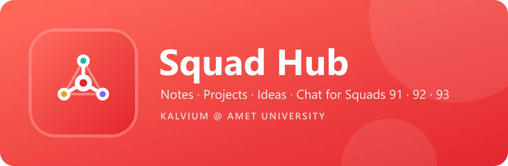

<p align="center">
  
</p>

<p align="center">
  
  
  
  
  
</p>

**Squad Hub** is a private app for the Kalvium @ AMET University batch: Squads **91**, **92** and **93**, 76 students plus the Admin and the Campus Manager. It's one place to share notes, show off projects, pitch ideas, ask doubts, chat, and keep up with deadlines.

---

## Features

| | Feature | What it does |
|---|---|---|
| 📚 | **Notes & resources** | Upload PDFs and images (up to 25 MB) or Drive links, tagged by subject, with search and squad filters |
| 🚀 | **Projects** | Showcase builds, with live GitHub stars, language and last update |
| 💡 | **Ideas** | Pitch, upvote, discuss and find teammates |
| ❓ | **Doubts** | Ask the batch; the asker accepts the answer that solved it |
| 🏆 | **Leaderboard** | Weekly, monthly and all-time points, plus a squad battle |
| 🔎 | **Search** | One box for people, posts and events |
| 👥 | **Students** | Everyone in the batch with photos and skills; Admin and CM also see phone, birthday, last active and who hasn't joined, and can export CSV |
| 🙋 | **Profiles** | Photo, name, mobile number, birthday, bio, skills and links; a welcome screen collects them on first sign-in |
| 💬 | **Chat** | A whole-batch room plus one private room per squad, live, with unread badges |
| 📅 | **Deadlines & events** | Moderators post deadlines, exams and hackathons; tap the bell for a reminder an hour before |
| 🔔 | **Notifications** | Inbox plus push to every phone a member is signed in on: posts, events, announcements, replies, accepted answers, birthdays and app updates. Post and chat alerts can be muted |
| 🎂 | **Birthdays** | At 8 AM IST the batch gets a reminder to wish whoever's birthday it is (members can opt out) |
| 📊 | **Analytics** | For Admin and CM: sign-ups per squad, 14-day activity, posts by type and squad, top contributors, profile completeness, storage used, app errors |
| 🛡️ | **Moderation** | Announcements, pinning, reports, member allowlist |
| 🔒 | **Privacy & account** | What's stored and who sees it; members can delete their account |
| ✨ | **Design** | Plus Jakarta Sans, brand gradients, squad colours, spring animations, dark mode |

### Roles

| Role | Who | Powers |
|---|---|---|
| **Admin** | Sujan Anandh S I (builder) | Everything |
| **Campus Manager** | Saru Priya | Everything, same as Admin |
| **Squad lead** | optional | Pin, moderate, add events |
| **Student** | the batch | Post, comment, like, save, chat |

Only emails on the allowlist can sign in, using a 6-digit code sent by email. Row Level Security on every table means nobody can read or change data they shouldn't.

---

## How updates reach phones

```
push to main ──► GitHub Actions ──► eas update ──► every installed APK
                                     (channel: preview)    downloads it on next launch
```

- **JavaScript, design and screen changes** go out on every push to `main`. Nobody needs to reinstall. The app downloads the update in the background and shows a **"new version is ready · Restart"** banner.
- **Tell everyone:** put `[notify]` in the commit message (or run the workflow by hand with *notify* ticked) and every phone gets a "Squad Hub updated ✨" push.
- **Native changes** (a new library with native code, app icon, permissions) need a new APK **and a version bump** in `app.json`, so old APKs never receive JavaScript they can't run: `npx eas-cli build -p android --profile preview`.
- In the app, **Me → About → Check for updates** pulls the latest update immediately.

| Workflow | When | Purpose |
|---|---|---|
| `ci.yml` | every push and PR | typecheck + lint |
| `eas-update.yml` | push to `main` | publishes an over-the-air update, and the update push when asked |
| `keep-alive.yml` | daily | pings Supabase so the free project never pauses |

---

## Tech stack

- **App:** Expo SDK 58, React Native 0.88, Expo Router, Reanimated 4, TypeScript
- **Backend:** Supabase (Postgres, Auth with email OTP, Storage, Realtime, pg_net)
- **Push:** Expo Push Service with Firebase Cloud Messaging
- **Builds & updates:** EAS Build (APK) and EAS Update

```
src/app/                  screens (Expo Router)
  (tabs)/                 Home, Notes, Projects, Ideas & doubts, Chat, Me
  chat/[channel].tsx      live chat room
  post/[id].tsx           post detail, likes, comments, accepted answers, share
  member/[id].tsx         a member's profile and posts
  students.tsx            batch directory (private details for Admin / CM)
  leaderboard.tsx         points and squad battle
  search.tsx              people, posts and events
  welcome.tsx             first sign-in profile setup
  privacy.tsx             privacy notice and account deletion
  events.tsx              deadlines & events calendar
  notifications.tsx       inbox
  analytics.tsx           Admin / CM dashboard
  admin.tsx               announcements, reports, allowlist
src/components/           cards, avatar, profile form, update banner, ui/* (buttons, chips, squad selector…)
src/lib/                  supabase client, queries, profile, chat, push, events, error reporting
supabase/migrations/      schema, security rules, triggers (run in order)
```

---

## Setup (for maintainers)

1. **Supabase:** run `supabase/migrations/0001…0004` in order in the SQL Editor, then your allowlist (copy `supabase/seed_allowlist.example.sql` to `seed_allowlist.sql`, which git ignores).
2. **Env:** `cp .env.example .env.local` and fill in the Supabase URL and publishable key.
3. **Run:** `npm install && npx expo start`.
4. **APK:** `npx eas-cli build -p android --profile preview`.

### Repository secrets

| Secret | Used by | Where to get it |
|---|---|---|
| `EXPO_TOKEN` | `eas-update.yml` | expo.dev → Account settings → Access tokens |
| `SUPABASE_URL`, `SUPABASE_PUBLISHABLE_KEY` | `keep-alive.yml` | Supabase → Project settings → API Keys |
| `SUPABASE_URL`, `SUPABASE_SECRET_KEY` | `eas-update.yml` (update push) | Supabase → Project settings → API Keys → **Secret key**. Never put it in the app or `.env` |

### Turning on push notifications

1. At [console.firebase.google.com](https://console.firebase.google.com), create a project and add an **Android** app with package `com.kalviumamet.squadhub`.
2. Download `google-services.json` into the project root, commit it (it holds no secrets), and add `"googleServicesFile": "./google-services.json"` under `expo.android` in `app.json`.
3. In Firebase → Project settings → **Service accounts** → **Generate new private key**. Upload that JSON at expo.dev → squad-hub → Credentials → Android → `com.kalviumamet.squadhub` → **FCM V1 service account key**. Never commit this key.
4. Build a new APK and have everyone install it once.

### Sign-in emails for the whole batch

Supabase's built-in email sender only allows a few emails per hour. Before promotion, connect your own SMTP (for example Resend or Brevo, both free at this size) in Supabase → Authentication → **Emails → SMTP settings**, then raise the email rate limit under Authentication → **Rate limits**.

---

## Roadmap

- [x] Doubt Q&A with accepted answers
- [x] Leaderboard (in-app points)
- [ ] LeetCode / GitHub stats on the leaderboard
- [ ] Hackathon team finder
- [ ] Attendance and sprint tracker

<p align="center">
  Designed &amp; built by <b>Sujan Anandh S I</b> · Squad 92 · Kalvium @ AMET University
</p>
